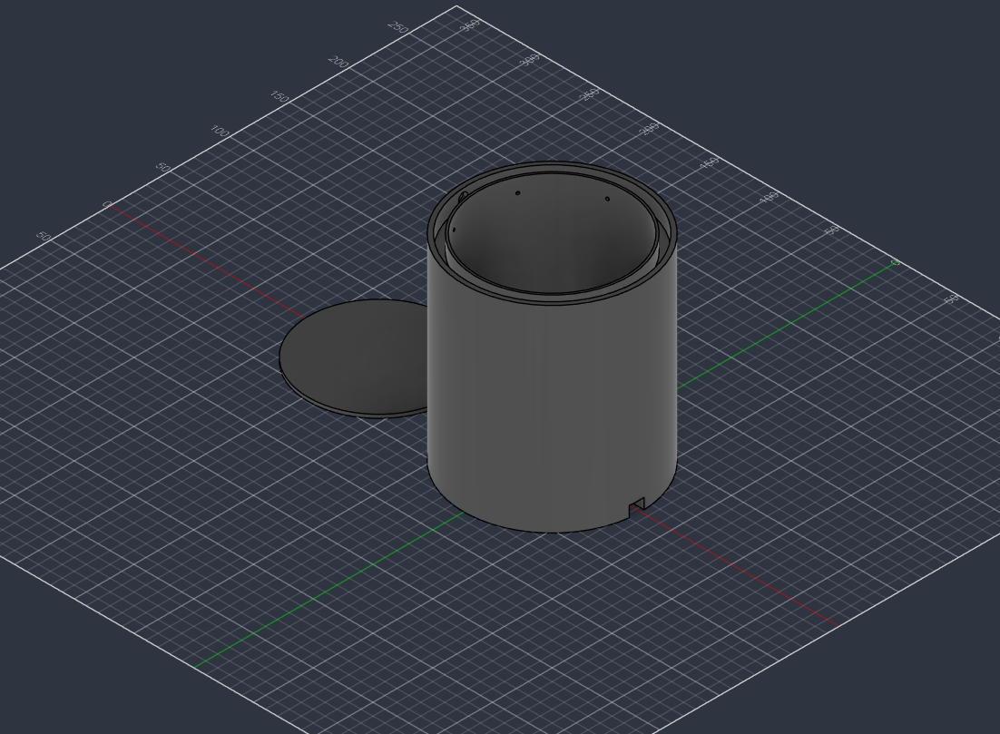
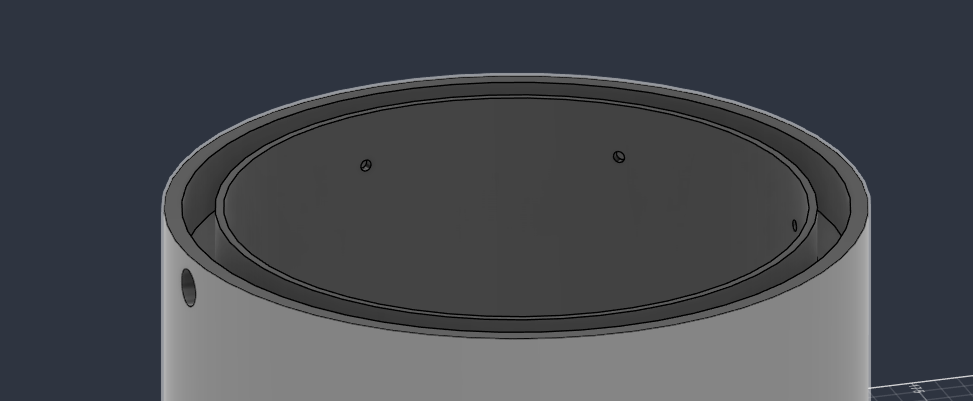
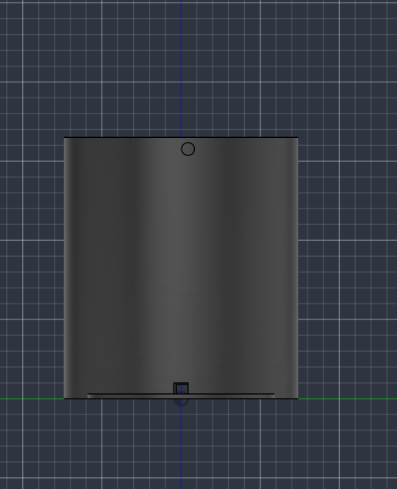
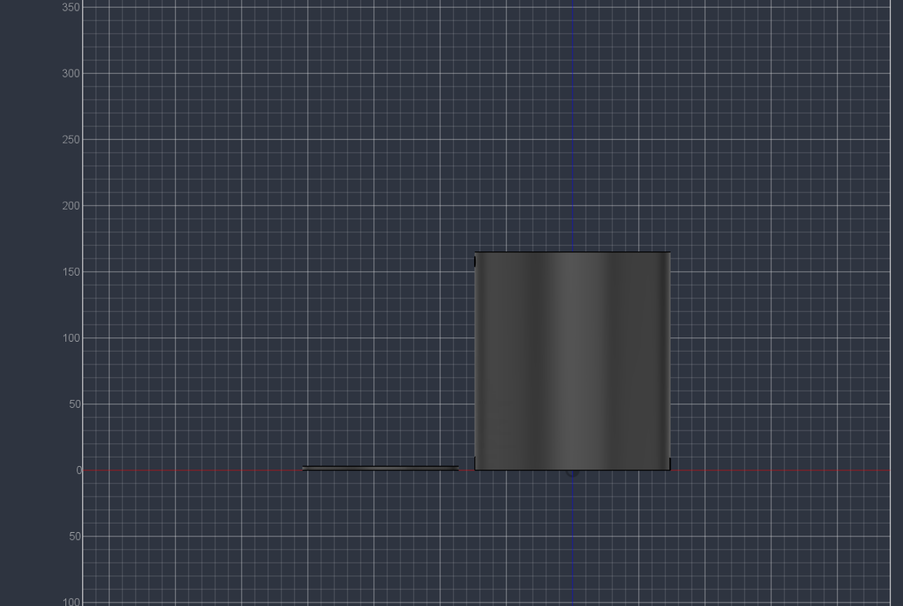
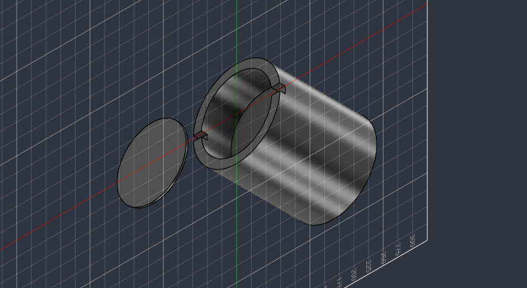
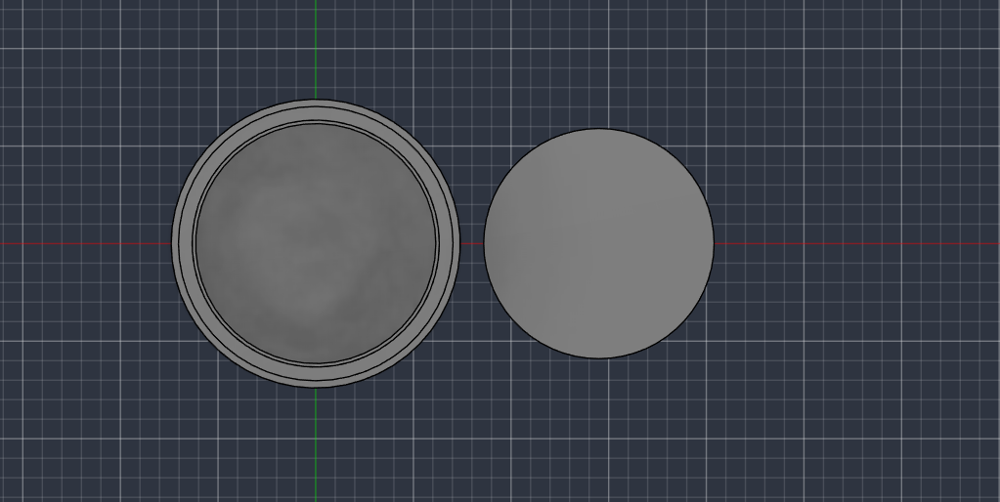

# Hidden Drip Pot

A 3D-printed self-watering plant pot with all of its electronics hidden underneath.

IMPORTANT: This is more like a temporary/fun solution to having for water plants, I do not recommend using this as a permanent solution.

A small pump fills a hollow channel around the rim of the pot, and the water dribbles onto the soil through a ring of 2.5 mm drip holes. A soil moisture sensor decides when to water. The Arduino, the pump driver and the wiring sit in a snap-shut compartment under the pot, so from the outside it just looks like a pot.





## Why I built it

The circuitry in a self-watering setup gets messy fast, and a breadboard full of jumper wires looks ugly next to a flower pot. My fix was to hide all of it under the pot.

The second problem was the code. Filling a small hollow channel accurately while also reading a soil moisture sensor was harder than I expected, so most of the code is about getting that right.

## How it works

1. The soil moisture sensor checks the soil every 30 minutes.
2. When the soil is dry, the pump pulls water from a cup and pushes it through the 8.15 mm inlet on the side of the pot.
3. The water fills the hollow channel inside the rim.
4. It dribbles out through the drip holes in the inner wall and spreads around the plant instead of soaking one spot.
5. The code waters in short pulses and checks the soil again until it's moist enough.



## Design

| Parameter | Value |
|---|---|
| Pot diameter | 123 mm |
| Pot depth | 112 mm |
| Overall height (pot and base) | about 165 mm |
| Outer wall | 4 mm |
| Hollow channel width | about 7 mm |
| Hollow channel depth | 13 mm |
| Inner (drip) wall | 2 mm |
| Drip holes | 2.5 mm diameter |
| Pump inlet | 8.15 mm diameter |
| Channel volume | about 30 mL |
| Electronics compartment | 120 mm diameter, 50 mm deep |
| Cable ports | 2, on opposite sides, 9 × 14 mm, 12 to 15 mm through |

I printed it with no supports and 10% infill. The walls that hold water are all perimeters, so the low infill doesn't affect them. Use at least 3 or 4 perimeters to keep the channel watertight.







## The watering problem

The channel holds only about 30 mL, and even a small pump fills it much faster than 2.5 mm holes can drain it. If the pump ran until the sensor read wet, the channel would overflow and dump water on one side, and the pot would be flooded by the time the water reached the sensor.

So the code waters in pulses. It fills the channel once, waits for it to drain, and does that twice. Then it waits about 10 minutes for the water to soak down to the sensor before deciding whether to go again. There's a timing mode so you can measure exactly how long your pump takes to fill the channel.

It also has two safety limits. It won't run more than 12 pulses a day, so a bad sensor can't empty the cup onto the table. If three watering rounds in a row don't raise the moisture reading, it assumes the cup is empty or the tube came loose, stops pumping and fast-blinks the onboard LED until you refill the cup and send `c`.

## Testing the code

I tested the code two ways:

- It compiles with no warnings for both the Arduino Nano Every and a classic Arduino Nano. It uses about 13% of the Nano Every's flash.
- I ran the real sketch on my computer against a simulated pot with a fake clock, a fake pump and a fake sensor.

| Scenario | Result |
|---|---|
| Soil starts at 20% | Watered in 6 pulses (9 s of pumping) and stopped at the 55% target |
| Soil already wet (70%) | Never ran the pump |
| Cup empty | Stopped after 3 rounds (6 pulses), blinked the LED, stayed off until `c` |
| Refill after the error, then send `c` | Started watering again and reached the target |
| Sensor stuck below the target | Stopped at the 12-pulse daily limit |
| Timing mode (`t`, Enter after 3 s) | Pump ran for about 3 s and printed the time |
| `millis()` rolling over at 49 days | Same result as the first test |

The simulation caught two bugs that I fixed. Timing mode used to stop the pump instantly, because the newline from typing `t` arrived a moment later and counted as the "stop" key. And the pulses that ran while the cup was empty were still counted toward the daily limit, so after a refill the pot stopped watering before it was moist enough. Clearing the error with `c` now resets the daily count.

<!-- TODO: add real-world testing once it's run with a plant: did every drip hole flow, what fillTime and drainTime ended up being, any leaks -->

## Components

Everything in the compartment fits in the 120 × 50 mm space with room to spare. The Nano Every is 45 × 18 mm and the MOSFET module is 44 × 32 mm.

| Qty | Part | Notes |
|---|---|---|
| 1 | Arduino Nano Every (ABX00028) | 45 × 18 mm, micro-USB. A classic Arduino Nano also works |
| 1 | DFRobot Gravity: Analog Capacitive Soil Moisture Sensor (SEN0193) | Capacitive, so it doesn't corrode in wet soil like the bare-metal kind. Runs on 3.3 to 5.5 V |
| 1 | DFRobot Gravity: Analog Sensor Cable for Arduino, 50 cm | Long enough to run from the soil over the rim and down to the base |
| 1 | Adafruit Submersible 3V DC Water Pump, Vertical Type (4547) | Draws about 100 mA. 45 mm long and 23.5 mm wide, so it sits in the cup |
| 1 | Adafruit Tubing for Submersible Pumps, PVC 6mm ID, 1 Meter (4545) | 8 mm outer diameter, which fits the 8.15 mm inlet |
| 1 | DFRobot Gravity: MOSFET Power Controller (DFR0457) | Switches the pump from an Arduino pin |
| 1 | 1N5819 Schottky diode | Flyback protection for the pump. The MOSFET module doesn't have one built in |
| 1 | Micro-USB cable and 5 V USB phone charger | Power |
| 1 | Cup or jar | Water reservoir |

The pump is rated for 3 V and the system runs on 5 V USB, so the code drives it at about 60% PWM (`pumpPower = 150`), which averages out to about 3 V.

## Wiring

```
MOSFET module VIN+ ────── Nano 5V
MOSFET module VIN− ────── Nano GND
MOSFET module VOUT+ ───── Pump red (+)
MOSFET module VOUT− ───── Pump black (−)
MOSFET module signal ──── D3   (Gravity cable: signal to D3, + to 5V, − to GND)
1N5819 across the pump    (striped end to pump red)

Sensor signal ─────────── A0
Sensor VCC ────────────── D7   (powered only while reading)
Sensor GND ────────────── GND
```

The USB cable goes through one port. The pump wire, the tube and the sensor cable go through the other.

## Code

The sketch is `self_watering_pot.ino`. To upload it:

1. Install the [Arduino IDE](https://www.arduino.cc/en/software).
2. In Tools → Board → Boards Manager, install Arduino megaAVR Boards. The Nano Every needs it.
3. Put `self_watering_pot.ino` in a folder called `self_watering_pot` and open it.
4. Select Tools → Board → Arduino megaAVR Boards → Arduino Nano Every and pick the right port.
5. Click Upload. You don't need any extra libraries.

### Calibrating

Open the Serial Monitor at 9600 baud with Newline selected. You only need to do this once.

1. Hold the sensor in the air and send `r`. Put the raw number in `dryRaw`.
2. Stand the sensor in a glass of water up to its line and send `r`. Put the raw number in `wetRaw`.
3. With the tube connected and the pump in the cup, send `t` to start the pump. Press Enter the moment the channel is full, and put the printed time in `fillTime`.
4. Send `p` to fill the channel once and time how long it takes to empty. Put that time, plus a few seconds, in `drainTime`.
5. Upload the sketch again.

### Settings

| Setting | Default | What it does |
|---|---|---|
| `dryPct` | 35 | Start watering below this |
| `wetPct` | 55 | Stop once it reaches this |
| `checkEvery` | 30 min | How often it checks the soil |
| `fillTime` | 1500 ms | Pump time to fill the channel once |
| `pumpPower` | 150 | Pump speed (0 to 255). 150 is about 3 V |
| `drainTime` | 30 s | Wait between pulses |
| `pulsesPerRound` | 2 | Fills per round (about 60 mL) |
| `soakTime` | 10 min | Wait for water to reach the sensor before checking again |
| `maxPulsesDay` | 12 | Hard limit (about 360 mL a day) |

Plants like different amounts of water, so adjust `dryPct` and `wetPct` for yours.

### Serial commands

| Command | Action |
|---|---|
| `r` | Read the sensor |
| `t` | Timing mode for calibrating `fillTime` |
| `p` | Run one pulse |
| `w` | Start a watering round now |
| `c` | Clear the error state and reset the daily count |
| `s` | Show status |

## Assembly

1. Print the pot and the base lid.
2. Wire up the Nano Every, the MOSFET module and the diode (see Wiring) and fit them in the compartment.
3. Push the sensor into the soil and run its cable over the rim and down through a port.
4. Put the pump in the cup, push the tube into the 8.15 mm inlet, and run the pump wire through the port.
5. Upload the code and calibrate.
6. Snap the lid shut and plug in the USB cable.

Keep the cup's water level below the inlet. If the cup sits higher than the rim, water can siphon through the pump and keep flowing after it stops.

## Files

| File | Description |
|---|---|
| `self_watering_pot.ino` | Arduino code |
| `01_rim_drip_holes_closeup.png` | Close-up of the rim, channel and drip holes |
| `02_isometric_view.png` | Isometric view of the pot and lid |
| `03_side_view_height.png` | Side view showing overall height |
| `04_bottom_view_compartment_and_lid.png` | Electronics compartment and lid |
| `05_top_view.png` | Top view |
| `06_front_view_inlet_and_port.png` | Front view with the pump inlet and cable port |
| `LICENSE` | Project license |

<!-- TODO: add the CAD and STL files to the repo and list them here -->

## Tools and materials

- <!-- TODO: CAD software used -->
- <!-- TODO: printer and filament -->
- Arduino IDE

## Future plans

- Decide on a proper reservoir. A cup works for now.
<!-- TODO: anything else you plan to add -->

## License

This project is open source. See LICENSE for the terms.
